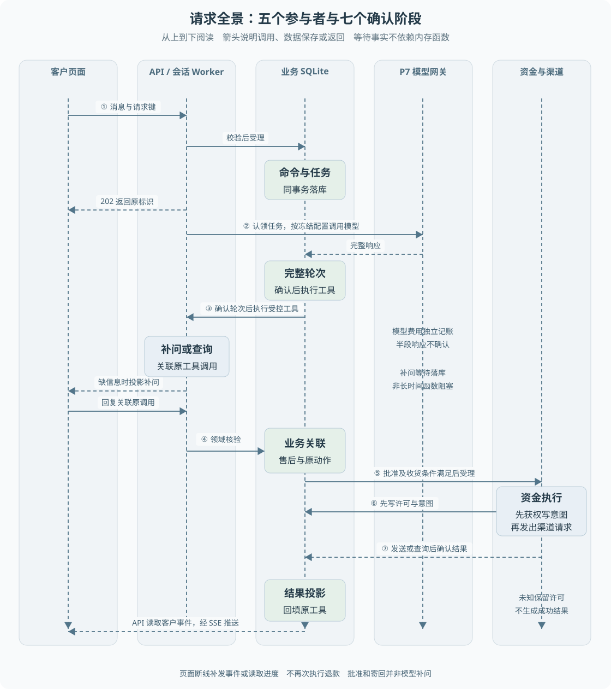

# 第 02 章 一次退款请求的全景

本篇解决一个问题：**一次客户退款请求，到底经过哪些代码？** 读完你应该能不看文档复述这条链路，并能在仓库里逐个找到对应的文件和函数。本章只讲主链，底层机制的细节留给后续章节。

> **阅读前提**：熟悉 HTTP 请求与异步函数，先读[第 01 章](01-售后业务与项目边界.md)。租约、CAS、费用账本等词先按职责理解即可，后面章节再展开。

## 贯穿案例

以下用一份**教学数据**走完整条正常路径，它不是测试夹具，也不是某次运行结果：

> 客户甲用一个未发货的已支付订单申请仅退款，金额 **29900 分（299 元）**，该订单此前没有售后记录。订单简称 `O1`，售后简称 `R1`，退款简称 `F1`，会话简称 `M1`。这些是教学别名，不能直接填进 API。

## 设计思路：为什么要拆成可确认的阶段

最小实现可以让 HTTP 路由调用模型，再调用退款函数，最后返回结果。这个方案在"客户信息齐全、渠道立即返回、进程不重启"时能跑通，但售后会等待补问、主管决定或客户寄回，持续时间远超一次普通请求；进程退出也会丢掉内存里的调用位置。

所以当前持久链路把**接受一次输入**与**完成售后**分开：受理时先保存命令和任务，响应只返回身份标识；后台 Worker 从数据库领取任务，再按已保存的状态推进。

> **几个词先按职责记住**（实现细节后面章节再看）：
> **Worker** 是"定期取出待办并执行的后台代码"，不是浏览器的 Web Worker，也不必每个任务新开一个操作系统进程。
> **命令**记住用户这次要求做什么；**任务**记住这一片段执行到哪里；**检查点**记住某一步已经确认的结果；**租约**给当前执行者一段有限时间的处理资格。

每个阶段都有对应的持久记录，所以系统能区分"模型轮次还没确认""退款已受理但未执行""业务已完成但客户事件尚未投影"。**恢复不必把所有阶段再跑一遍**，这正是后面每一站都能从检查点继续的原因。

## 系统整体流向



图 2-1 的标题是"五个参与者与七个确认阶段"，它把一次请求拆成五条泳道和七个带编号的确认点：

| 泳道 | 图上的编号 | 这一段在确认什么 |
| --- | --- | --- |
| 客户页面 | ① 消息与请求键 | 客户这次输入是什么 |
| API / 会话 Worker | ① 校验后受理、② 认领任务、③ 确认轮次后执行受控工具 | 输入已保存、模型轮次已完整 |
| 业务 SQLite | ② 命令与任务（同事务落库）、③ 完整轮次（确认后执行工具）、④ 业务关联 | 哪些事实已经落到同一事务里 |
| P7 模型网关 | ② 完整响应、模型费用独立记账 | 半段响应不算确认 |
| 资金与渠道 | ⑤ 批准及收货条件满足后受理、⑥ 先写许可与意图、⑦ 发送或查询后确认结果 | 资金动作是否已被允许、是否已发出、结果是否明确 |

读图时注意三件事：**模拟渠道在图里属于"资金与渠道"这条泳道的最右侧**，没有单独画一条；**SSE 是图底部"API 读取客户事件，经 SSE 推送"这段标签**，不是独立泳道；**数据库里的矩形表示已经确认的记录**，横向实线是调用，虚线是返回或事件推送，纵向虚线只用于对齐泳道。

## 先理解这 6 个节点

先只记住每个节点的输入、动作和产出，不要急着记状态枚举和事务细节。

| 节点 | 输入 | 做了什么 | 产出 | 源码入口 |
| --- | --- | --- | --- | --- |
| ① 客户页面 | 客户文字 + 身份 | 提交消息与请求键，订阅事件流 | 一次 HTTP 提交、一个事件订阅 | [`CustomerWorkspace.tsx`](../../../apps/web/src/components/customer/CustomerWorkspace.tsx)、[`api.ts`](../../../apps/web/src/lib/api.ts) |
| ② API | HTTP 请求、认证结果、`Idempotency-Key` | 校验身份与输入，保存命令与任务，立刻返回受理结果 | `202` + 运行／命令／任务标识 | [`app.ts`](../../../apps/api/src/app.ts) |
| ③ 会话 Agent | 已保存的命令与任务 | 重建消息历史，调模型，确认完整轮次，执行只读工具，把结果回填原调用 | 新的模型轮次、工具结果、或一次补问等待 | [`durable-conversation.ts`](../../../packages/runtime/src/durable-conversation.ts) |
| ④ 业务判定与持久化 | 模型的退款工具意图 | 重读订单与政策，生成售后与退款方案，建立原动作关联 | 售后、退款、授权与关联记录 | [`p6-conversation-refund.ts`](../../../packages/persistence/src/p6-conversation-refund.ts) |
| ⑤ 资金 Worker 与模拟渠道 | 已授权的资金计划 | 取得发送许可、写发送意图、调用或查询渠道、结算结果 | 资金效果记录与任务终态 | [`p6-worker.ts`](../../../packages/runtime/src/p6-worker.ts)、[`p6-payment-simulator.ts`](../../../packages/persistence/src/p6-payment-simulator.ts) |
| ⑥ 事件与 SSE | 已确认的业务结果 | 把结果回填原工具调用，生成客户可见事件，按游标推送 | 页面可读的进度与事件流 | [`sse.ts`](../../../apps/api/src/sse.ts)、[`customer-view.ts`](../../../apps/api/src/customer-view.ts) |

## 源码跟读

下面从 HTTP 入口开始，沿着真实调用走。每一站都给出**代码入口**、**输入与输出**、**一个关键实现点**和**最容易误解的地方**。

### 站点 0：先确认你打开的是哪条路径

**业务上发生了什么**：客户在页面点下发送，请求到达 API。

**为什么先做这一步**：仓库里同时存在持久路径和旧兼容路径，两者的响应契约不同。**当前持久入口不是无条件默认的，它取决于启动方式。**

- 官方离线入口会显式设置 `P6_BUSINESS_MODE=simulation`：`scripts/dev-offline.ts` 与 `compose.yaml` 都设了它；该变量使装配产生 `system.conversations`。
- 直接裸跑 `apps/api/src/main.ts` 而不设该变量时，`system.conversations` 为 `undefined`，请求落入旧兼容分支，返回的是 `201 { runId }`。

**代码入口**：`apps/api/src/model-entry.ts` 的 `resolveApiModelEntry()`，以及 `apps/api/src/app.ts` 里 `POST /api/runs` 的 `if (system.conversations)` 分支。

**最容易误解的地方**：看到 201 不代表文档写错了，而是启动方式不同。**持久路径返回 202 加四个标识，兼容路径返回 201 只加一个 `runId`。**

### 站点 1：HTTP 只确认受理

**业务上发生了什么**：服务端确认"这次输入我记住了"，然后立刻返回，不等模型、不等退款。

**输入 → 输出**：客户消息 + 身份 + 请求键 → `202 Accepted`，响应体是 `runId`、`commandId`、`taskId`、`accepted`。

**代码入口**：`apps/api/src/app.ts` 的 `POST /api/runs` → `system.conversations.accept(...)`。

```ts
// apps/api/src/app.ts 创建会话先保存客户输入 持久模式由后台继续处理
const task = system.conversations.accept(customerId, key, body.data.message, undefined, undefined, snapshot)
return context.json(
  { runId: task.runId, commandId: task.commandId, taskId: task.taskId, accepted: true },
  202,
)
```

这三个标识分工不同：`runId` 关联整个会话，`commandId` 记录这次受理内容，`taskId` 用于后台调度。页面需要保存运行身份才能继续查进度，**但不能从编号猜测业务结果**。

**最容易误解的地方**：
- **202 只表示任务已受理。** 它不表示模型已回答，更不表示退款已发生。
- 客户补充信息的 `POST /api/runs/:runId/messages` 走持久分支时返回的 202 **只有 `runId`、`commandId`、`accepted`，没有 `taskId`**。两个端点的字段集不同。
- 网络在响应返回前断开时，客户不能随便换请求键重复提交，应先按相同请求身份取回原结果。

### 站点 2：请求键与业务键分别防什么

**业务上发生了什么**：同一次输入被重放时，服务端要认出"这是原来那次"，而不是新建一次工作。

**代码入口**：`packages/persistence/src/conversation-journal.ts` 的 `accept()`，以及 `packages/persistence/src/p6-task-repository.ts` 的 `accept()`。

```ts
// packages/persistence/src/conversation-journal.ts 同键冲突必须在写入前报错 不静默复用另一条消息
const existing = this.tasks.findRequest(customerId, requestKey)
if (existing) {
  if (JSON.stringify(existing.input.requestPayload) !== JSON.stringify(payload)) {
    throw new DomainError(createToolError('CONFLICT', '请求键已用于不同消息'))
  }
  return existing
}
```

这一层比较的是**原始请求载荷**；任务仓储那一层还会再算一次 sha256 指纹比对，同键同参返回原任务，同键异参抛"请求幂等键内容冲突"。

**最容易误解的地方**：请求键保护的是**一次 HTTP 输入**，不是整笔退款。同一诉求如果每次都新建售后单，就会得到不同的退款业务键。真正约束"这一笔退款只有一个身份"的是 `refund:<售后单号>` 这个业务键，规则很短，可以直接读：

```ts
// packages/contracts/src/idempotency.ts 幂等键由业务身份确定性生成
export function refundIdempotencyKey(returnNo: string): string {
  return `refund:${returnNo}`
}
```

### 站点 3：会话 Worker 取模型轮次

**业务上发生了什么**：后台认领任务，重建上下文，调模型，并且**只接受完整的一轮输出**。

**输入 → 输出**：已保存的命令、任务与事件历史 → 一个完整 `Turn`（文本块 + 工具调用块），或一次明确失败。

**代码入口**：`packages/runtime/src/durable-conversation.ts` 的 `execute()` 主循环与 `collect()`。

主循环的三行决定了恢复行为：

```ts
// packages/runtime/src/durable-conversation.ts 每轮先读已确认检查点 有则复用 不再调用模型
for (let step = 1; step <= (this.options.maxTurns ?? 12); step++) {
  signal.throwIfAborted()
  let turn = this.journal.tasks.step(task.taskId, `turn:${step}`) as Turn | undefined
  if (!turn) { /* 调模型并收集完整轮次 */ }
```

`collect()` 的角色是把流式片段拼回一个可执行轮次，它明确拒绝半成品：

```ts
// packages/runtime/src/durable-conversation.ts 只收集完整且已通过 P7 协议校验的轮次
if (!complete) throw new Error('模型轮次未完成')
for (const block of blocks)
  if (block.type === 'tool_use') block.input = JSON.parse(inputs.get(block.toolCallId) || '{}')
```

轮次收集完成后才提交，并把检查点一起写入：

```ts
this.journal.commit(task, `turn:${step}`, turn, () => {
  this.journal.append(task.runId, 'agent.turn', { blocks: confirmed.blocks, stopReason: ... })
})
```

**最容易误解的地方**：
- **半段 JSON 不是可执行参数。** 参数按 `toolCallId` 累积在内存里，只有拿到完成标记才解析；`max_tokens` 截断会直接抛"模型轮次截断"。
- 默认轮次上限是 **12 个模型轮次**（`maxTurns`），指一次持久会话任务，不是整个客户会话终身只能问 12 次。注意旧 `AgentRunner` 用的名字是 `maxSteps`，是另一个常量。
- 当前持久路径**不做逐 token 落库**，只在确认后落一条 `agent.turn`；逐段落的 `message.delta` 只存在于旧 `AgentRunner`。

### 站点 4：只读工具执行与结果回填

**业务上发生了什么**：模型请求查订单或查政策，宿主校验后执行，结果绑定回原调用。

**代码入口**：同文件的 `read()`，调用点在主循环的工具执行分支。

```ts
// packages/runtime/src/durable-conversation.ts 只读取白名单资源
if (name !== 'get_order' && name !== 'get_shipment') throw new Error('工具不在只读白名单')
const input = ToolIO[name].input.parse(args)
const order = await new SqliteOrderRepository(this.db).findByOrderNo(input.orderNo)
if (!order || order.customerId !== customerId) throw new Error('订单归属不匹配')
```

**最容易误解的地方**：
- **工具目录只是边界的一部分。** 模型看不到某个工具，不等于服务端会拒绝直接调用它的请求；这里的白名单和归属校验才是执行时的关口。
- 工具结果以**原 `toolCallId`** 写回（`agent.tool_results`），不是一段无来源的助手说明。配对错了，就可能把 A 订单的事实用到 B 订单上。
- 只读工具失败会形成 `isError: true` 的结果让模型知道没查到，而不是编一个占位事实。

### 站点 5：模型意图转为确定性业务

**业务上发生了什么**：模型提出 `submit_refund_only`。**这只是意图**，业务层要重新读订单和政策，自己算钱。

**输入 → 输出**：工具名 + 允许的诉求字段 → 售后单、退款、执行权、审批与"原工具调用关联"记录，在同一事务内提交。

**代码入口**：`packages/runtime/src/durable-conversation.ts` 把动作交给 `P6ConversationRefundRepository.submit(...)`；实现在 `packages/persistence/src/p6-conversation-refund.ts`。

```ts
// packages/persistence/src/p6-conversation-refund.ts 模型只提供诉求字段 金额和授权必须来自服务端业务事实
if (name !== 'submit_refund_only' && name !== 'submit_return')
  throw new Error('此动作未迁移 请升级人工')
if (
  Object.keys(call.input).some(
    (key) => !(name === 'submit_return'
      ? ['orderNo', 'reason', 'itemIds', 'explanation']
      : ['orderNo', 'reason', 'explanation']).includes(key),
  )
)
  throw new Error('模型不得指定金额或业务授权关联')
```

这是白名单式拒绝：任何额外字段（`amount`、`amountCents`、`approvalId`、授权关联等）都会让整个受理失败。金额改由领域函数产出，并在同一次受理里固化下来。原动作关联记录里保存了 `run_id`、`origin_task_id`、`step_key`、`tool_call_id`、`tool_name`、`return_no`、`approval_id` 等身份，它回答的是**"这个业务结果应该回填给哪个模型动作"**。

**最容易误解的地方**：
- **工具调用是意图，不是执行。** 模型给出合法 JSON，只说明它能这样表达，不说明业务允许。
- 受理会按**当前**事实重判：如果在模型查询之后订单已经发货，要以重读结果为准，不能沿用模型缓存的"尚未发货"。
- 批准方式决定何时才有可执行方案：自动批准、主管审批、退货等待三条分支不同，退货等待批准后也**不会**立即发钱。

### 站点 6：资金 Worker 执行已授权计划

**业务上发生了什么**：后台 Worker 拿到已授权的计划，先取得发送许可并写下发送意图，然后才真正请求渠道。

**代码入口**：`packages/runtime/src/p6-worker.ts` 的 `execute()`，配合 `packages/persistence/src/p6-task-repository.ts` 的 `beginPayment()` 与 `settle()`。

```ts
// packages/persistence/src/p6-task-repository.ts 已有意图只允许转查询 即使还没有成功记录也不能重新发送
beginPayment(claim, payment, prepare?) {
  return this.fenced(claim, () => {
    const task = this.assertOwned(claim)
    if (task.cancelRequested || task.deadline <= this.now()) return false
    if (this.effect(payment)) return false
    prepare?.(this.db, payment, task)
    this.db.prepare(`INSERT INTO p6_effects VALUES (?,?,?,'sending',NULL,?)`)
      .run(payment.businessKey, fingerprint(payment), JSON.stringify(payment), claim.taskId)
    return true
  })
}
```

`beginPayment` 的返回值直接决定这次是"发送"还是"查询"：

```ts
// packages/runtime/src/p6-worker.ts 只有本次事务新建资金意图才允许首次发送
const shouldSend = this.repo.beginPayment(task, payment, this.ports.preparePayment)
result = shouldSend
  ? await this.call(signal, (s) => this.ports.payment.execute(payment, s))
  : await this.call(querySignal, (s) => this.ports.payment.query(payment.businessKey, s))
```

**模拟渠道在这一站的最右侧**：它用 `business_key` 做主键，`submissions` 记录收到多少次提交，`charges` 记录发生过多少次成功资金动作。两者分开记，是为了能回答"是重复提交了，还是重复扣款了"。

**最容易误解的地方**：
- **发送许可和业务批准是两件事。** 批准决定这笔业务是否允许执行，发送许可决定当前这条执行路径能不能发出请求。
- **渠道调用发生在本地事务提交之后。** 不能把网络等待包在数据库事务里。
- 本地写入和外部渠道不可能由一个事务覆盖，这个空窗就是第 14 章要处理的核心问题。

### 站点 7：业务结果与页面状态

**业务上发生了什么**：渠道确认后，后台不只是改退款单，还要把结果回填给**原来那次工具调用**，并生成客户可见事件。

**代码入口**：`packages/persistence/src/p6-conversation-refund.ts` 的 `project()`、`packages/runtime/src/durable-business.ts` 的 `runOnce()`、`apps/api/src/sse.ts`、`apps/api/src/customer-progress.ts`。

客户进度不是挑一个最乐观的字段展示，而是**多项事实联合核验**：

```ts
// apps/api/src/customer-progress.ts 售后 退款 资金效果与发送许可必须共同确认成功
const succeeded =
  record.status === 'completed' &&
  refund?.status === 'succeeded' &&
  effect?.status === 'succeeded' &&
  ownership?.owner === 'p6' &&
  ownership.state === 'succeeded' &&
  ownership.confirmed === 1
```

SSE 只负责传送**已经落库**的事件。隐藏的内部事件会推进游标但不公开内容，所以客户事件序号允许跳跃；前端不能把跳号直接判成丢消息。

**最容易误解的地方**：
- **助手文案"退款成功"不是数据源。** 真正的进度来自业务记录。
- **重连只补事件或重新读进度，不重执行业务。**
- 业务已完成，但客户事件尚未投影，是一个合法中间状态。此时正确的恢复动作是补投影，而不是再退一次。

## 关键交接处

这五条是本章最容易被读混的地方，单独列出来：

1. **HTTP 返回 202 只代表受理。** 输入与待办已保存，业务尚未发生。
2. **模型 Tool Call 是意图，不是执行本身。** 合法 JSON 只说明模型能这样表达。
3. **业务层重新核验可信事实。** 金额、归属、资格来自订单与政策，不来自模型参数。
4. **资金发送与结果确认分开。** "允许执行""已经发出""渠道明确确认"是三个阶段。
5. **业务完成与客户端看到结果分开。** 业务终态已提交、客户事件未投影，是正常状态。

## 跟读后的自测

先合上文档，用三句话复述一次请求经过哪些代码，然后对照下面的检查点。

| 检查点 | 你应该说出的内容 |
| --- | --- |
| 入口与响应 | `POST /api/runs` → `system.conversations.accept(...)` → `202 { runId, commandId, taskId, accepted }`；不设 `P6_BUSINESS_MODE=simulation` 时会走 201 兼容分支 |
| 受理写什么 | 命令与任务同事务落库；请求键 + 请求载荷摘要识别重放，同键异参报冲突 |
| 模型轮次 | `DurableConversation.execute` 按 `turn:<step>` 检查点复用；`collect()` 要求完整轮次，半段流不执行 |
| 工具执行 | `read()` 只读白名单 + 订单归属校验；结果按原 `toolCallId` 回填 |
| 业务受理 | `P6ConversationRefundRepository.submit` 拒绝金额与授权字段，领域函数产出金额并固化原动作关联 |
| 资金执行 | `beginPayment` 先写意图并返回发送许可；`shouldSend` 为真才 `execute`，否则 `query` |
| 结果回填 | `project()` 回填原工具结果；客户进度联合核验五项事实；SSE 只推送已落库事件 |

如果你能说出"退款金额在领域受理那一步确定，之后只推进状态、不重算金额"，这一章就过关了。

## 用故障位置定位问题

先判断断在哪一层，再决定动作。只有 4 个最常见场景，更深的故障窗口见[第 14 章](../05-资金执行与恢复/14-退款幂等与结果未知.md)与[第 16 章](../05-资金执行与恢复/16-跨进程恢复与人工核验.md)。

| 现象 | 先看什么 | 不要直接做什么 |
| --- | --- | --- |
| 提交后没有回复 | 请求是否受理、任务状态、模型调用记录 | 换请求键重复提交 |
| 一直等待审批 | 原审批状态与执行意图 | 让模型宣布批准 |
| 后台成功但页面没变 | 结果投影、事件游标、客户进度查询 | 再执行一次资金动作 |
| 渠道超时 | 原业务键的渠道查询与资金效果 | 清理发送状态后重发 |

## 继续深入

| 想弄清的问题 | 去哪一章 |
| --- | --- |
| 为什么先查后写防不住并发、条件更新怎么写 | [06 事务、唯一约束与条件更新](../02-后端必要基础/06-事务唯一约束与条件更新.md) |
| 受理与完成为什么不是一回事 | [07 状态机与异步任务](../02-后端必要基础/07-状态机与异步任务.md) |
| 工具协议、完整轮次、停止条件的完整实现 | [09 原生工具调用与 Agent 循环](../04-Agent机制/09-原生工具调用与Agent循环.md) |
| 发送许可、未知结果、两个故障窗口 | [14 退款幂等与结果未知](../05-资金执行与恢复/14-退款幂等与结果未知.md) |
| 租约、代次与围栏写入 | [15 Worker、租约与检查点](../05-资金执行与恢复/15-Worker租约与检查点.md) |
| 取消、重启、人工核验的边界 | [16 跨进程恢复与人工核验](../05-资金执行与恢复/16-跨进程恢复与人工核验.md) |
| 模型预算与费用账本 | [18 模型预算与费用](../06-交互与运行治理/18-模型预算与费用账本.md) |
| 评测怎么证明上面这些性质 | [20 测试、L1、L2 与 Judge](../07-验证与设计取舍/20-测试L1L2与Judge.md) |

## 验证依据与取舍

[客户退款进程测试](../../../apps/api/test/conversation-refund-process.test.ts)从正式客户 HTTP 发起流程，并在业务受理、批准受理、渠道响应、结果投影和退货等待等边界退出或停止进程。历史[实验记录](../../experiments/p6-conversation-refund.md)检查了退款、渠道计数、原工具结果与客户事件，不只检查响应码。

这些证据支持命名故障条件下的本机恢复。当前正式离线主链路使用模拟模型与本机渠道，**不提供真实模型效果和真实支付的保证**。

流程拆分的代价是增加了状态表、关联记录与恢复代码；换来的是长等待和进程退出不再依赖单个请求函数的生命周期。

---

本章学习衔接：[源码跟读实验](../09-练习与自测/源码跟读实验.md) · [渐进重建练习一与二](../09-练习与自测/渐进重建练习.md) · [集中自测第 02 组](../09-练习与自测/集中自测.md) · [返回导学](../导学-有据售后.md)

业务对照：[B04-仅退款的完整业务实现](../03-业务逻辑详解/B04-仅退款的完整业务实现.md) · [B05-退货后退款的完整业务实现](../03-业务逻辑详解/B05-退货后退款的完整业务实现.md)。
