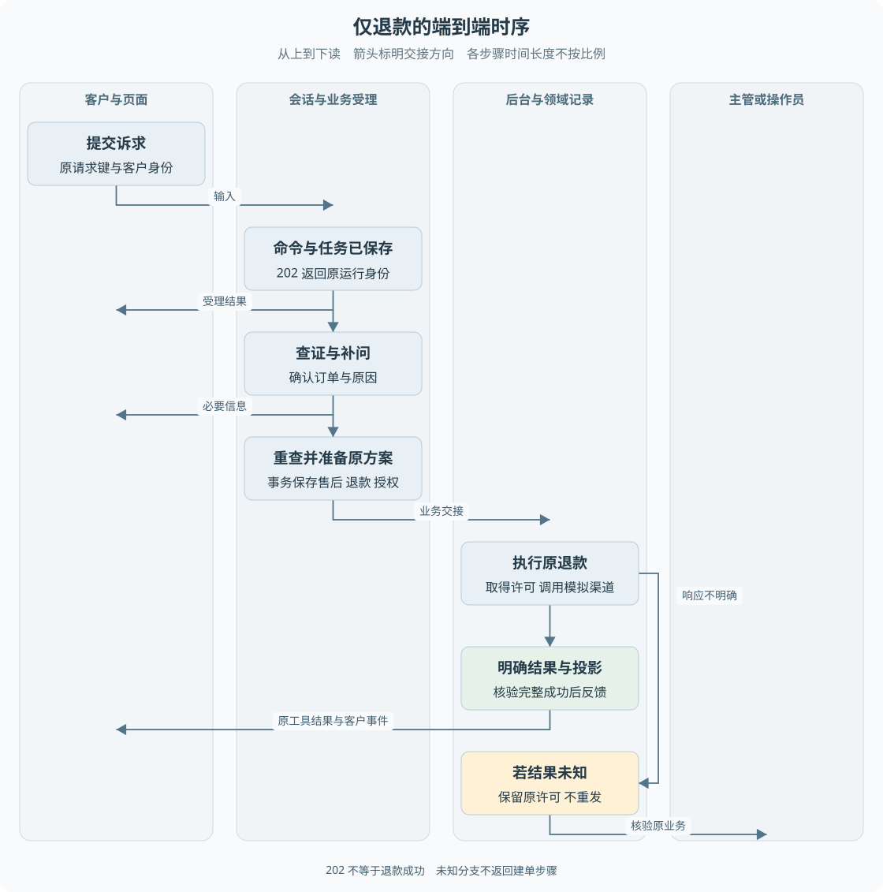

# B04 仅退款的完整业务实现

客户取消尚未发货的订单，看起来只需要一个退款动作。对系统而言，它必须先把模糊诉求变成可信方案，再交给资金执行，最后向正确的客户确认结果。

**本篇只讲业务规则和记录变化**：资格怎么判、金额从哪来、单据之间什么关系、每一步谁接手。Agent Runtime 的协议细节见[第 09 章](../04-Agent机制/09-原生工具调用与Agent循环.md)，资金幂等与恢复见[第 14 章](../05-资金执行与恢复/14-退款幂等与结果未知.md)，全景时序见[第 02 章](../01-项目全貌/02-一次退款请求的全景.md)。

> **阅读前提**：**建议先读**[B02](B02-业务对象与状态关系.md)、[B03](B03-售后资格与金额如何判定.md)。HTTP 返回码与请求幂等可随时查[第 04 章](../02-后端必要基础/04-HTTP接口与身份边界.md)。如果直接读本章：记录之间的关系见"售后单、退款单、任务是什么关系"，资格与金额来源见"订单归属、资格与金额：代码怎么判"，这两节都写在本章内。

## 一笔仅退款的完整案例

以下是一份**教学数据**，用来固定后续推导。它不是测试夹具，也不是某次运行结果：

> 客户甲买了一件 299 元商品，订单**已支付且未发货**，没有已有售后。客户说"还没发货，我想取消并退款"。

订单简称 `O1`，售后简称 `R1`，退款简称 `F1`，会话简称 `M1`。金额 299 元即 **29900 分**。



图 B04-1 分四条泳道：客户与页面、会话与业务受理、后台与领域记录、主管或操作员。中间标注了三个关键转折点：**受理结果**（202 返回原运行身份）、**业务交接**（重查并准备原方案，事务保存售后、退款、授权）、**原工具结果与客户事件**。右下角的"响应不明确"分支写着"保留原许可，不重发"，并连回**核验原业务**而不是返回建单步骤。图底部那句话值得单独记住：**202 不等于退款成功，未知分支不返回建单步骤。**

## 设计思路：为什么把受理、判断、执行和反馈分开

如果 API 收到一句"退款"后一直等模型、数据库和支付全部完成再返回成功响应，任何一步超时都会让客户端不知道发生了什么；用户再次点击时，系统还可能创建第二笔业务。**解决方法不是把超时时间调大，而是把各阶段保存成可以再次查询的事实。**

业务上可以分成四段，每段都有明确输入、结果和下一位负责人：

1. **受理输入**：返回运行与任务身份，确认系统已保存待办。
2. **补齐事实**：会话执行器查询、补问，再提出结构化动作。
3. **保存方案**：在数据库事务中重查并保存原业务，交给资金任务。
4. **确认与反馈**：确认渠道结果，再把结果投影回原会话。

> **关键区别**：前三段中任何一段完成，都**不能单独证明退款成功**。

这也解释了为什么当前会有会话 Worker 和业务 Worker 两种角色：前者回答"客户想办理什么、还缺哪些信息"，后者执行"已经确定的原方案"。批准后的付款不需要模型重新想一遍金额，更不应该因为重启重新生成一笔退款。

## 阶段、判定、记录与下一位责任者

这张表是本章的主干。读的时候重点看两列：**记录变化**说明这一步到底写了什么，**此时不能宣称什么**说明最容易说过头的地方。

| 阶段 | 可信输入 | 业务判定 | 记录变化 | 下一位责任者 | 此时不能宣称什么 |
| --- | --- | --- | --- | --- | --- |
| ① 客户提交诉求 | 客户文字、认证身份、请求键 | 身份与输入格式校验；同键同参重放返回原受理 | 命令与任务同事务落库（`p6_commands`、`p6_tasks`）、运行事件 | 会话 Worker | 不能说已经建了售后单 |
| ② 查证与补问 | 消息历史、订单／物流／政策查询结果 | 还缺哪些必要信息、是否可以提交 | 完整模型轮次（`agent.turn`）与工具结果事件 | 客户（补信息）或领域受理 | 查到订单**不等于**获得退款授权 |
| ③ 领域受理 | 模型的工具意图（订单号、原因等诉求字段） | 订单归属、重复售后、政策结果、金额、是否需要审批 | 售后单 `R1`、退款单 `F1`、执行权、审批（如需）、原调用关联，**共同提交** | 资金任务／主管／客户（寄回） | 建了 `F1` 不等于钱已退 |
| ④ 资金执行 | 原售后单与冻结金额、原授权关联 | 任务资格、原业务授权、是否已有发送意图 | 发送意图、渠道结果、本地结算 | 后台资金 Worker | 渠道没有明确结果前不能说成功 |
| ⑤ 结果确认与投影 | 渠道终态、售后与退款状态、执行权 | 多项事实联合核验 | 退款 `succeeded`、售后 `completed`、原工具结果、客户可见事件 | 客户页面 | 事件尚未送达时不能说客户已看到 |

盖住表格，你应该能回答：**29900 分在哪一步确定？之后哪些步骤只推进状态、不再重算金额？** 答案是领域受理那一步确定，后续执行核验并使用原金额。客户再问一次进度，也不会让 `F1` 变成 `F2`。

## 四种"成功"必须分开

这是本篇最需要建立的习惯：不要用一个"成功"覆盖所有阶段。

| 层次 | 例子 | 它是谁的结论 | 还不能说明什么 |
| --- | --- | --- | --- |
| 用户表达的诉求 | "没发货，我想取消退款" | 客户 | 信息可能不全，也未必符合政策 |
| 模型提出的工具意图 | `submit_refund_only(orderNo, reason, explanation)` | 模型 | 格式合法只说明模型能这样表达 |
| 领域层接受的业务方案 | 售后 `R1` 自动批准、退款 `F1` 预留 **29900 分** | 领域代码按可信事实判定 | 钱还没有离开账户 |
| 资金执行结果 | 渠道明确 `succeeded`，五项事实一致 | 渠道结果 + 业务记录 | 客户可能还没收到最后一条事件 |

## 订单归属、资格与金额：代码怎么判

### 归属和重复申请在同一个入口拒绝

模型的意图进入 `P6ConversationRefundRepository.submit`，它只接受已迁移的两种退款动作，并且**只允许诉求字段**。任何金额或授权字段都会让整次受理失败：

```ts
// packages/persistence/src/p6-conversation-refund.ts 模型只提供诉求字段 金额和授权必须来自服务端业务事实
if (name !== 'submit_refund_only' && name !== 'submit_return')
  throw new Error('此动作未迁移 请升级人工')
if (
  Object.keys(call.input).some(
    (key) => !(name === 'submit_return'
      ? ['orderNo', 'reason', 'itemIds', 'explanation']
      : ['orderNo', 'reason', 'explanation']).includes(key),
  )
)
  throw new Error('模型不得指定金额或业务授权关联')
```

### 领域方案从可信事实生成

受理调用领域服务 `AfterSaleService.prepareReturnRequest(...)`。它的职责是**同步生成方案，不写库、不调用渠道**，所以能被放进更大的事务里复用。三项判断按顺序发生：

```ts
// packages/domain/src/services/after-sale-service.ts
// 1 归属：订单号一致且（客户身份下）客户号一致
if (order.orderNo !== input.orderNo ||
    (actor.role === 'customer' && order.customerId !== actor.customerId))
  throw new DomainError(createToolError('AUTHORIZATION_DENIED', '无权访问该订单'))
// 2 重复：同订单已有活跃申请就拒绝新建 并非只检查选中商品是否重复
const active = existing.find((r) => ACTIVE_RETURN_STATUSES.includes(r.status))
if (active) throw new DomainError(createToolError('CONFLICT', `该订单已有进行中的售后单 ${active.returnNo}`))
// 3 已完成售后仍占位：不能据此支持剩余商品再次分批退款
const refunded = existing.find((r) => r.status === 'completed' && r.type !== 'exchange')
if (refunded) throw new DomainError(createToolError('CONFLICT', `该订单已完成过售后 ${refunded.returnNo} 不能重复申请`))
```

**金额来自第三次判定，不来自前两步，也不来自模型**：

```ts
// packages/domain/src/services/after-sale-service.ts 使用可信订单 物流和时钟计算 客户与模型不直接决定金额
const decision = decidePolicy({ type: input.type, reason: input.reason, order, shipment,
  itemIds: input.itemIds ?? null, clock: this.clock })
```

`decidePolicy` 由政策规则给出 `refundAmountCents`、`outcome`、`ruleId`、`explanation`，并冻结 `policyVersion`。**这就是"模型负责表达诉求、代码负责算钱"的落点。**

## 售后单、退款单、任务是什么关系

三个对象职责不同，不能合并：

| 对象 | 例子 | 回答什么问题 | 关键字段 |
| --- | --- | --- | --- |
| 售后单 `ReturnRequest` | `R1`（`RT-...`） | 客户申请的是什么、政策怎么判、是否需要审批 | `type`、`reason`、`status`、`refundAmountCents`、`policyDecision`、`policyVersion` |
| 退款单 `Refund` | `F1`（`RF-...`） | 这笔钱要按什么身份退 | `amountCents`、`currency`、`channel`、`status`、`idempotencyKey` |
| 持久任务 `p6_tasks` | 会话任务、资金任务 | 哪一段后台工作还没做完 | `tool`、`status`、`owner`、`generation`、`lease_until` |

三者通过稳定身份串起来，而不是靠"当前只有一个悬空动作"来猜：

```ts
// packages/domain/src/services/after-sale-service.ts 预留只确定原资金身份 不发送款项 待审批方案也会预留
refund = {
  refundNo: this.noGenerator.nextNo('RF'),
  returnNo,
  amountCents: decision.refundAmountCents,
  status: 'created',
  idempotencyKey: refundIdempotencyKey(returnNo),   // refund:<售后单号>
  ...
}
```

**`F1` 的 `status: 'created'` 只表示保留了一个资金身份**，不表示钱已发出。业务状态（售后单）和资金状态（退款单、资金效果）各有自己的事实来源，不共用同一个 `completed` 字段。

## 三条分支：自动批准、人工审批、退货等待

政策结果直接决定售后单的初始状态，这是三条不同路径的起点：

```ts
// packages/domain/src/services/after-sale-service.ts 政策结果决定初始状态 submitted 只是瞬时起点
const targetStatus = decision.outcome === 'allow'
  ? 'auto_approved'
  : decision.outcome === 'needs_approval' ? 'awaiting_approval' : 'rejected'
```

| 分支 | 触发条件 | 记录变化 | 谁继续推进 |
| --- | --- | --- | --- |
| 自动批准 | 政策 `allow` 且是仅退款 | 售后 `auto_approved`，退款预留，同事务接管执行权并创建资金任务 | 资金 Worker |
| 人工审批 | 政策 `needs_approval`（例如金额较大） | 售后 `awaiting_approval`，审批与执行意图绑定原方案 | 主管决定 |
| 退货等待 | 政策 `allow` 且类型是退货／换货 | 售后直接进入 `awaiting_buyer_shipment` | 客户寄回 → 操作员收货 |
| 政策拒绝 | `deny` | 落一条 `rejected` 售后**供解释与审计，不创建退款单** | 会话解释结果 |

**自动批准不等于直接调用支付。** 它仍然要经过持久受理、执行权保护和渠道确认，只是授权来源不同。**人工批准也不等于资金完成。**

## 结果怎样回到原工具动作

后台确认成功后，不只是更新退款单，还要让售后、资金效果和执行权处于一致结果，然后把结果**回填给最初那次工具调用**。`project()` 只处理尚未投影的关联，并带一个去重标识，所以重启扫描不会重复生成终态结果。

客户进度不是挑一个最乐观的字段，而是联合核验五项事实：

```ts
// apps/api/src/customer-progress.ts 售后 退款 资金效果与发送许可必须共同确认成功
const succeeded =
  record.status === 'completed' &&
  refund?.status === 'succeeded' &&
  effect?.status === 'succeeded' &&
  ownership?.owner === 'p6' &&
  ownership.state === 'succeeded' &&
  ownership.confirmed === 1
```

**某一处写了成功、其他证据缺失时，应显示待核验，而不是挑最乐观的一项展示。** 投影还有一项责任：保护人工处理状态——后台完成原业务时可以保存结果，但不应擅自覆盖已由坐席接管的会话。

## 重新申请会重查当前订单与政策

这是业务设计里最容易被忽略、面试却常问的一点。

1. 模型查询订单时看到"未发货"，但客户补充信息期间订单可能已经发货。
2. 真正提交申请时，`prepareReturnRequest` **重新读取当前订单、物流与已有售后**，以重读结果为准，不沿用模型缓存的结论。
3. 因此同一句"帮我退款"，在业务状态变化后可能得到不同结果——**这不是不稳定，而是按当前事实判断**。
4. 若该订单已有进行中或已完成的售后，第二次申请会被 `CONFLICT` 明确拒绝，而不是悄悄产生第二笔退款。

## 常见失败应该怎样理解

| 现象 | 业务含义 | 正确处理 |
| --- | --- | --- |
| 订单不存在 | 客户可能选错单号 | 先核对客户选择，不进入资金流程 |
| 订单属于其他客户 | 越权访问 | 拒绝并留审计，不泄露订单信息 |
| 政策不满足 | 合法申请被拒 | 保留被拒售后与解释，不创建退款单 |
| 需要主管审批 | 正常等待，不是失败 | 保存 `awaiting_approval`，不宣布结果 |
| 渠道明确拒付 | 已获得否定结果 | 记为业务失败，与"结果未知"区分 |
| 渠道没有明确结果 | 资金事实尚未确定 | 保留许可等待核验，**不重发、不宣布失败** |

重复提交还要分两层：相同请求重放应找回原命令；换请求键再次申请则由业务层检查同订单已有售后。**客户端禁用按钮不能防止其他浏览器、网络重试或后台进程重复推进**，所以这些判断必须留在后端。

## 教学重建顺序

如果想自己搭一遍，这个顺序让每层复杂度都对应一个真实问题。**它是教学重建顺序，不是项目的历史开发过程。**

1. **先去掉模型**：用固定表单收集订单和原因，实现可信查单、领域判断、售后与退款关联。
2. **加入持久受理和后台执行**：让页面通过查询看到"处理中"和最终结果。
3. **再加入模型**：替代表单中的信息收集，但复用原来那套领域判断与业务受理。

模型解决表达不明确，事务解决本地半写入，任务解决跨请求推进，资金键和核验解决外部结果不确定。

## 源码参考

| 顺序 | 业务问题 | 源码 | 搜索符号 | 阅读重点 |
| --- | --- | --- | --- | --- |
| 1 | HTTP 到底受理了什么 | [`app.ts`](../../../apps/api/src/app.ts) | `/api/runs`、`system.conversations` | 202 只表示输入受理 |
| 2 | 重复请求怎样定位原工作 | [`conversation-journal.ts`](../../../packages/persistence/src/conversation-journal.ts) | `accept` | 请求键与原始载荷比对 |
| 3 | 模型意图怎样转交业务 | [`durable-conversation.ts`](../../../packages/runtime/src/durable-conversation.ts) | `execute`、`submit_refund_only` | 对话循环与受控提交的交接点 |
| 4 | 哪些记录必须共同保存 | [`p6-conversation-refund.ts`](../../../packages/persistence/src/p6-conversation-refund.ts) | `submit` | 售后、退款、授权、原调用关联 |
| 5 | 归属、重复与金额怎样判 | [`after-sale-service.ts`](../../../packages/domain/src/services/after-sale-service.ts) | `prepareReturnRequest`、`decidePolicy` | 金额来自政策而非模型 |
| 6 | 后台怎样继续原业务 | [`durable-business.ts`](../../../packages/runtime/src/durable-business.ts) | `runOnce` | 扫描、受理与结果投影 |
| 7 | 结果怎样回复原申请 | [`p6-conversation-refund.ts`](../../../packages/persistence/src/p6-conversation-refund.ts) | `project` | 回填的原工具调用身份 |
| 8 | 页面何时能显示成功 | [`customer-progress.ts`](../../../apps/api/src/customer-progress.ts) | `succeeded`、`uncertain` | 业务状态、资金效果与执行权 |

## 验证依据

[退款闭环测试](../../../apps/api/test/conversation-refund.test.ts)包含补问、一次资金提交、重复申请、整体回滚、未知许可及取消后保留成功结果；[跨进程测试](../../../apps/api/test/conversation-refund-process.test.ts)提供另一类恢复依据。

测试夹具使用**模拟渠道**，不等于真实支付接入；本次未执行资金演示。历史[实验记录](../../experiments/p6-conversation-refund.md)中的 29900 分案例出自本机隔离夹具，可用来对照计数与状态，但不能外推为真实渠道行为。

---

学习衔接：[业务练习 B04](../09-练习与自测/业务流程练习.md#b04) · [源码跟读实验](../09-练习与自测/源码跟读实验.md) · [下一章](B05-退货后退款的完整业务实现.md) · [总导学](../导学-有据售后.md)
