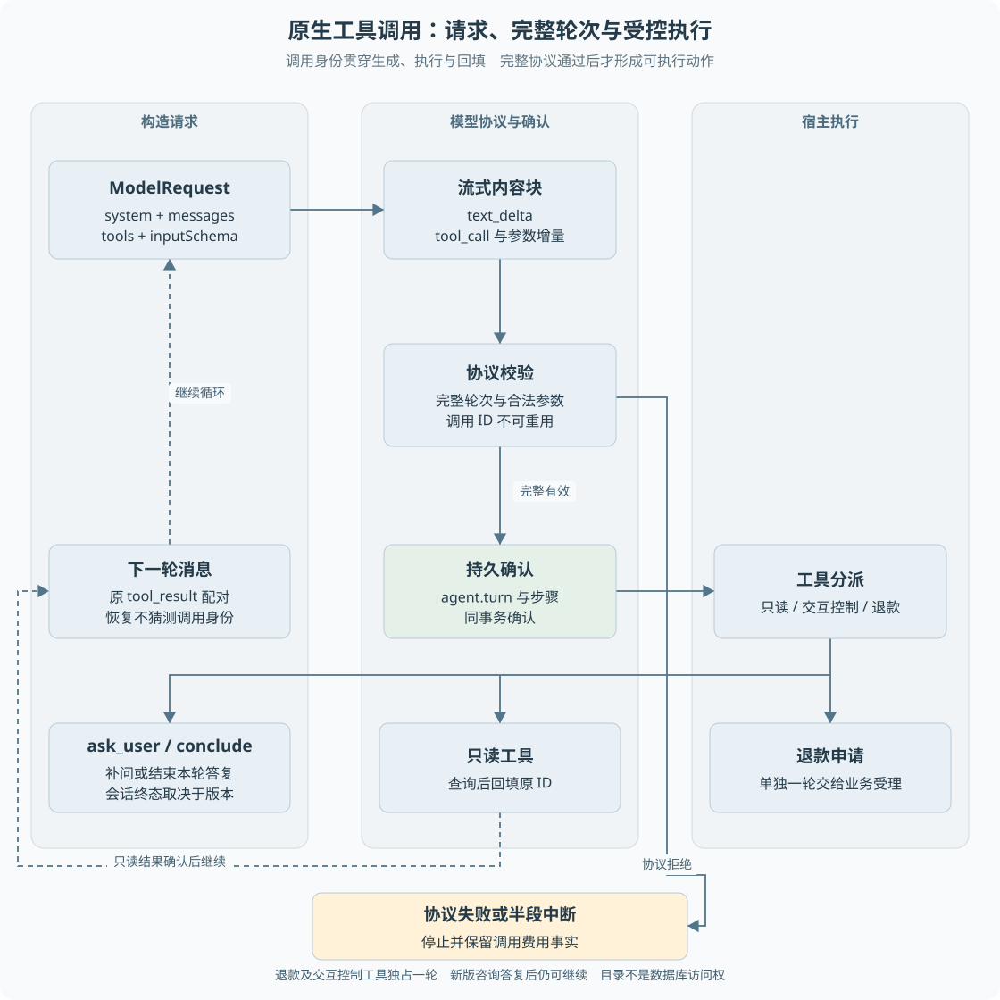

# 第 09 章 原生工具调用与 Agent 循环

模型回复"我正在查询订单"并不意味着真的查询了数据库。宿主需要一个明确协议，知道模型请求哪个工具、参数是什么，以及执行结果应该回给哪一次调用。

本篇分两层：**先用最小机制让你真正学会一个 Agent Loop，再映射到 Ju-agent 的实现**。第一层是教学示意，不是仓库代码；第二层每一条都能落到真实的文件和函数。

> **阅读前提**：先读[第 08 章](08-Agent与确定性工作流的分工.md)，理解异步函数和 JSON。本章解释消息角色与调用配对，不需要先使用某个 Agent 框架。

## 第一层：最小 Agent Loop

### 设计思路：为什么不能靠解析文本

最小做法是要求模型输出一段 JSON，再由程序解析工具名和参数。它能工作，但文本说明、格式错误、输出截断和多工具结果配对会逐渐增加解析负担：模型可能把 JSON 包在解释里、可能少一个括号、也可能同时给出两个调用。

于是项目定义与提供商无关的 `ChatModel`，把模型输出统一成文本增量、工具调用起始、工具参数增量和轮次完成四类事件；适配器负责翻译供应商协议，运行时负责校验和执行。

### 六个步骤

一个能用的工具调用循环只有这六步，缺任何一步都会出问题：

1. **构造请求**：系统提示 + 历史消息 + 工具目录，共同组成一次模型请求。工具目录里每个工具带名称、描述和输入 Schema。
2. **收集一轮输出**：按 `toolCallId` 累积参数片段，区分"文本块"和"工具调用块"。**参数没收集完整就不能执行。**
3. **校验完整协议**：必须拿到完整轮次；工具名必须在目录里；参数结构必须合法；新出现的调用标识不能和历史上用过的重复。
4. **持久确认这一轮**：把完整轮次保存下来，作为"已经确认的事实"。
5. **执行并回填结果**：只读工具的结果绑定回**原调用标识**；有副作用的动作交给受控业务受理，而不是适配器直接执行。
6. **继续或停止**：有新的观察就进入下一轮；需要客户补充就暂停；达到上限或协议错误就停止。

> 下面这段是**教学示意，不是项目原始代码**。它的作用是让你先看清数据怎么流动，真实实现见"第二层"。

```ts
// 教学示意 非项目原始代码
async function agentLoop(request: ModelRequest): Promise<void> {
  const messages = [...request.messages]
  for (let step = 0; step < MAX_STEPS; step++) {
    // 1~3. 收集并校验完整的一轮
    const turn = await collectCompleteTurn(model, { ...request, messages })
    if (!turn.complete) return              // 半段 JSON 不是可执行参数
    saveConfirmedTurn(turn)                 // 4. 先确认，再执行
    const calls = turn.blocks.filter((b) => b.type === 'tool_use')
    if (calls.length === 0) return          // 纯文本轮次，按停止协议处理
    for (const call of calls) {
      const result = await dispatch(call)   // 5. 宿主执行，模型不碰数据库
      messages.push({ role: 'user', content: [
        { type: 'tool_result', toolCallId: call.toolCallId, content: result },
      ] })
    }
  }
}
```

### 必须分清的五个协议概念

| 概念 | 回答什么问题 | 常见误解 |
| --- | --- | --- |
| 工具调用意图 | 模型**想**做什么 | 以为模型已经做了 |
| JSON Schema | 参数**形状**是否合法 | 以为形状合法就等于业务允许 |
| `toolCallId` | 这个结果回答的是**哪一次**调用 | 用工具名匹配结果 |
| 工具结果回填 | 把观察放回模型的上下文 | 把结果当普通文本追加，丢掉来源 |
| 停止条件 | 这一轮之后是继续、等待还是结束 | 靠模型自己说"我做完了" |

这里最容易被低估的是 `toolCallId`。**即使两次调用同一个工具，结果也不能只靠工具名匹配。** 如果结果配错了调用，模型就可能把 A 订单的事实用到 B 订单上；如果漏了结果，提供商的原生协议会因为"悬空的工具调用"直接拒绝请求。

因此下一轮消息必须至少包含：模型曾提出的工具调用，以及与之配对的结果。

```text
assistant: tool_use(id=call_1, name=get_order, input={orderNo: ...})
user:      tool_result(id=call_1, content=订单查询结果)
assistant: 根据结果选择下一步
```

只塞一段"订单未发货"的普通文本，会同时丢掉三件事：它来自哪个工具、回应哪个动作、是否已经执行。多个工具并行或跨进程恢复时，这种丢失会直接导致配对失败。

## 第二层：映射到 Ju-agent

先把全景看清。图 9-1 把请求、模型协议和宿主执行分成三个区域，标题是"调用身份贯穿生成、执行与回填，完整协议通过后才形成可执行动作"。



读图时注意三个细节，它们和仓库里的真实约束一一对应：

- 中间的**协议校验**框写着"完整轮次与合法参数，调用 ID 不可重用"——这对应 `collect()` 和跨轮 ID 检查（亮点 2、3）。
- 下面的**持久确认**框写着"`agent.turn` 与步骤同事务确认"——对应每轮检查点（亮点 4）。
- 右侧**工具分派**区分"只读／交互控制／退款"三条路径，退款那条写着"单独一轮交给业务受理"——对应独占一轮的约束（亮点 6、7）。

### 亮点 1：适配层把供应商输出统一成项目内部协议

**问题**：不同供应商的流式事件格式不同，主循环不应该到处判断供应商专有字段。

**做法**：项目定义与提供商无关的 `ChatModel` 端口，把模型输出统一成四类事件：

```ts
// packages/agent/src/model.ts 供应商无关的流事件
export type ModelStreamEvent =
  | { type: 'text_delta'; text: string }
  | { type: 'tool_call_start'; toolCallId: string; toolName: string; thoughtSignature?: number[] }
  | { type: 'tool_input_delta'; toolCallId: string; partialJson: string }
  | { type: 'turn_completed'; stopReason: 'end_turn' | 'tool_use' | 'max_tokens'; usage: ModelUsage }
```

适配器负责翻译，运行时负责校验和执行。`packages/runtime/src/p7-protocol.ts` 把 Anthropic 的 `input_schema`／`tool_use`／`tool_result` 和 OpenAI 的 `function.parameters`／`tool_call_id` 各自编码成这套事件。

**对应到整个流程**：这是"模型可替换"的前提，也是评测能注入脚本化模型的原因——上层只认这四类事件。

### 亮点 2：流式参数必须完整收集，半段不能执行

**问题**：一个 JSON 对象可能分多片到达。连接在参数闭合前断开时，页面已经看到部分文字，但宿主并没有可执行参数。

**做法**：`collect()` 在内存里按 `toolCallId` 累积文本和参数片段，只有拿到完成标记才解析：

```ts
// packages/runtime/src/durable-conversation.ts 只收集完整且已经通过 P7 协议校验的轮次
if (!complete) throw new Error('模型轮次未完成')
for (const block of blocks)
  if (block.type === 'tool_use') block.input = JSON.parse(inputs.get(block.toolCallId) || '{}')
```

`stopReason === 'max_tokens'` 会抛"模型轮次截断"。**注意事件名是 `tool_input_delta`，字段是 `partialJson`**，不是 `tool_args_delta`。

**代价**：客户不一定获得逐 token 的持久对话体验。当前持久路径把"避免半个工具参数触发业务"放在"展示及时性"之前。

### 亮点 3：`toolCallId` 让调用、结果和历史保持配对

**问题**：恢复时新进程必须还原出合法的消息序列，不能靠猜测。

**做法**：从事件重建消息，同时维护两个集合处理"已提出但尚无结果"的调用：

```ts
// packages/agent/src/context.ts 从事件重建原生消息历史 连续 tool_result 合并为单个 user 轮
export function rebuildMessages(events: EventRow[]): ModelMessage[] {
```

`unansweredCalls` 记录已经发出但没有结果的调用，`seenCalls` 记录当前仍待回填的调用；`agent.tool_results` 到达时按 `toolCallId` 配对，`message.user` 里的 `replyToToolCallId`（客户对补问的回复）也合成一条真正的 `tool_result`。

同一份约束在协议层再校验一次：`p7-protocol.ts` 的 `validateP7Request` 会拒绝**跨轮重用**已经出现过的 `toolCallId`，也拒绝悬空的 `tool_use`。持久路径还会提前自查一次：

```ts
// packages/runtime/src/durable-conversation.ts 跨轮 ID 重用直接判定协议错误
if (turn.blocks.some((block) => block.type === 'tool_use' && used.has(block.toolCallId)))
  throw new P7Error('PROTOCOL')
```

### 亮点 4：持久入口先确认完整模型轮次，再执行工具

**问题**：如果先执行动作、再保存轮次，进程在中间退出就会留下"动作做了但记录没有"的断层。

**做法**：轮次确认与检查点在同一事务里提交，工具执行发生在这之后：

```ts
// packages/runtime/src/durable-conversation.ts 确认之后才保存轮次 然后才处理工具
this.journal.commit(task, `turn:${step}`, turn, () => {
  this.journal.append(task.runId, 'agent.turn', {
    blocks: confirmed.blocks,
    stopReason: confirmed.blocks.some((block) => block.type === 'tool_use') ? 'tool_use' : 'end_turn',
  })
})
```

每个工具结果也独立确认，键是 `tool:<step>:<toolCallId>`，所以同一轮里多个动作的确认进度可以被分别识别：

```ts
// packages/runtime/src/durable-conversation.ts 已确认的工具步骤不重复执行
const key = `tool:${step}:${call.toolCallId}`
if (this.journal.tasks.step(task.taskId, key) !== undefined) continue
```

**对应到整个流程**：恢复时"已确认的轮次"和"已确认的工具结果"分别复用。**恢复保留的是已确认的协议事实，不保证每次外部模型计算只发生一次。**

### 亮点 5：工具目录与 Schema 只是边界的一部分

**问题**：模型看不到某个工具，不等于服务端会拒绝一个直接调用它的请求。

**做法**：工具目录决定"模型通常能表达什么"，执行时还要校验身份、资源归属和业务规则。只读工具走白名单加归属检查：

```ts
// packages/runtime/src/durable-conversation.ts 只读取白名单资源 金额或动作参数永远不能到达旧支付执行器
if (name !== 'get_order' && name !== 'get_shipment') throw new Error('工具不在只读白名单')
const order = await new SqliteOrderRepository(this.db).findByOrderNo(input.orderNo)
if (!order || order.customerId !== customerId) throw new Error('订单归属不匹配')
```

搜索政策还要核对知识快照版本：原版本不在当前库时明确失败，**不把新语料静默当作旧运行的知识依据**。

### 亮点 6：退款申请交给受控业务受理

**问题**：模型可以用合法 JSON 表达一个越权或金额错误的退款申请。

**做法**：受理层做白名单式字段校验，任何金额或授权字段都会让整次受理失败：

```ts
// packages/persistence/src/p6-conversation-refund.ts 模型只提供诉求字段 金额和授权必须来自服务端业务事实
if (name !== 'submit_refund_only' && name !== 'submit_return')
  throw new Error('此动作未迁移 请升级人工')
if (
  Object.keys(call.input).some(
    (key) => !(name === 'submit_return'
      ? ['orderNo', 'reason', 'itemIds', 'explanation']
      : ['orderNo', 'reason', 'explanation']).includes(key),
  )
)
  throw new Error('模型不得指定金额或业务授权关联')
```

更硬的一层在**装配**上：会话执行器注入的支付端口根本不可用，被调用就直接抛错。

```ts
// packages/runtime/src/durable-conversation.ts 会话侧的端口全部关闭 资金动作只能走业务受理
payment: {
  execute: async () => { throw new Error('资金执行未开放') },
  query: async () => { throw new Error('资金执行未开放') },
},
applyPayment: () => { throw new Error('资金执行未开放') },
```

**这就是"模型不能自报可信金额、审批或资金结果"在代码里的落点**：不是靠提示词请求它别这么做，而是这条路径上没有可用的资金函数。

### 亮点 7：`ask_user`、`conclude`、`escalate` 与业务终态不是一回事

**问题**：模型输出一段纯文本，可能是完整回答，也可能是在问客户问题。只看文字会误判。

**做法**：用协议工具显式区分，并且**同一个工具在不同冻结版本下语义不同**：

| 输出或动作 | 当前如何解释 | 会话状态 |
| --- | --- | --- |
| `ask_user` | 正在等某项必要信息，保存原调用 ID | `awaiting_input`（补问） |
| `conclude`（guidance 版） | 本轮普通咨询已答复，**仍可继续追问** | `awaiting_input`，`consultation=ready` |
| `conclude`（较早工具版本） | 按旧契约结束会话 | `completed` |
| `escalate` | 升级人工 | `escalated` |
| 没有工具调用的纯文本轮次 | 不凭文字猜业务完成 | `awaiting_input` |

判断依据是运行时冻结的工具版本，不是工具名的字面意思：

```ts
// packages/runtime/src/durable-conversation.ts guidance 下 conclude 只结束本轮答复
const status = call?.toolName === 'conclude'
  ? (guidance ? 'awaiting_input' : 'completed')
  : call?.toolName === 'escalate' ? 'escalated' : 'awaiting_input'
```

新版 `conclude` 还会补齐自身的工具结果，保证客户下次追问时消息协议仍然完整。**所以"结束本次模型调用""结束一轮答复""结束客户会话""退款成功"是四个不同结论。**

### 亮点 8：轮数、时限、尝试与预算分别控制不同风险

这四种限制经常被混成一句"防死循环"，但它们管的不是同一件事：

| 限制 | 管什么风险 | 实际取值与来源 |
| --- | --- | --- |
| 模型轮数 | 单个任务无限循环调用模型 | `maxTurns`，默认 **12**（`durable-conversation.ts`） |
| 任务时限 | 任务长期占用执行资格 | 受理时写入 `deadline`，Worker 侧到期中止 |
| 任务尝试次数 | 同一任务反复失败重排 | `P6Worker` 的 `maxAttempts`（会话侧为 **3**），超限转失败 |
| 网关尝试次数 | 供应商瞬时故障 | 快照 `maxAttempts`：真实模型入口为 **1**，持久会话为 **3**；契约上限 3 |
| 预算预占 | 并发与重试越过费用上限 | 每次尝试调用前预占，完整用量才结算 |

还有一条容易忽略的：网关**只对 `RATE_LIMITED` 和 `UPSTREAM` 重试**，超时和连接中断不自动重试——因为超时可能留下远端在途请求。

### 新旧路径必须分开说

仓库里同时存在两套循环，把旧特性说成当前默认会直接讲错：

| 能力 | 旧 `AgentRunner`（`packages/agent/src/agent.ts`） | 当前 `DurableConversation`（默认持久入口） |
| --- | --- | --- |
| 工具目录 | 查单成功后动态放开动作工具（能力门控） | 进入循环前按运行快照确定一次 |
| 增量持久化 | 文本与参数逐段落 `message.delta`／`tool.input.delta` | 不写 delta，只在提交时落一条 `agent.turn` |
| 写入方式 | 直接写事件表 | `journal.commit` + 检查点，在围栏事务内写 |
| 资金路径 | 经旧 `WorkflowEngine` | 会话侧端口关闭，交给业务受理 |

`app.ts` 是按运行归属分流的：`system.conversations?.owns(runId)` 命中则走持久路径，否则回落到旧 `system.runner`。**所以"当前默认"必须绑定具体端点或启动方式**，不能说成一句全局结论。

## 失败如何回到循环

- **只读工具失败**：形成 `isError: true` 的工具结果，让模型知道没查到。它不能用占位内容编造订单状态。
- **协议或模型调用失败**：持久会话停止为明确错误（`call_failed`），不再由 Worker 套一层模型重试，避免供应商尝试与任务重试相乘。
- **退款业务受理失败**：事务回滚后回填明确的失败结果，不退回旧资金执行器。
- **同一轮同时要求补问和退款**：宿主直接拒绝，而不是任选一个执行。

```ts
// packages/runtime/src/durable-conversation.ts 独占一轮 防止未完成配对
if (actions.length && calls.length !== 1) throw new Error('退款动作必须单独调用')
if (terminal.length && calls.length !== 1) throw new Error('终止工具必须单独调用')
```

## 源码阅读路径

按这个顺序读，每一步都只回答一个问题：

1. **协议形状**：[`packages/agent/src/model.ts`](../../../packages/agent/src/model.ts) —— 请求、消息块、流事件、`ChatModel` 端口是什么样。
2. **工具目录**：[`packages/agent/src/tool-defs.ts`](../../../packages/agent/src/tool-defs.ts) —— 工具名、描述、JSON Schema 从哪来（由共享 Zod 契约生成）。
3. **消息重建**：[`packages/agent/src/context.ts`](../../../packages/agent/src/context.ts) 的 `rebuildMessages` —— 配对关系怎么还原。
4. **协议校验**：[`packages/runtime/src/p7-protocol.ts`](../../../packages/runtime/src/p7-protocol.ts) —— 什么才算"完整轮次"，哪些情况判 `PROTOCOL`。
5. **持久循环**：[`packages/runtime/src/durable-conversation.ts`](../../../packages/runtime/src/durable-conversation.ts) 的 `execute` → `collect` → `read` —— 确认、执行、回填的先后顺序。
6. **业务交接**：[`packages/persistence/src/p6-conversation-refund.ts`](../../../packages/persistence/src/p6-conversation-refund.ts) 的 `submit` —— 意图如何变成受控方案。
7. **对照实验**：[`packages/agent/src/agent.ts`](../../../packages/agent/src/agent.ts) 的 `prepareStepTools` —— 看清旧路径的动态门控与当前路径的差别。

## 自测问题

1. 为什么半段 JSON 参数不能触发工具执行？当前代码在哪里拒绝它？
2. `toolCallId` 除了配对，还在哪一层被用来拒绝非法请求？
3. 如果模型在同一个轮次里既调用 `ask_user` 又申请退款，会发生什么？为什么这样设计？
4. 旧 `AgentRunner` 的"查单后动态放开工具"为什么不能用来描述当前持久入口？
5. 一个模型轮次最多 12 次，能不能推出"单笔业务费用一定可控"？还缺哪几层限制？

---

本章学习衔接：[源码跟读实验](../09-练习与自测/源码跟读实验.md) · [渐进重建练习三](../09-练习与自测/渐进重建练习.md) · [集中自测第 09 组](../09-练习与自测/集中自测.md) · [返回导学](../导学-有据售后.md)

业务对照：[B04-仅退款的完整业务实现](../03-业务逻辑详解/B04-仅退款的完整业务实现.md)。

**验证依据**：原生工具调用改善的是协议结构，不保证模型一定选对工具。接口兼容、参数合法、业务正确和客户任务完成，需要由不同层的测试与评测分别证明，见[第 20 章](../07-验证与设计取舍/20-测试L1L2与Judge.md)。
