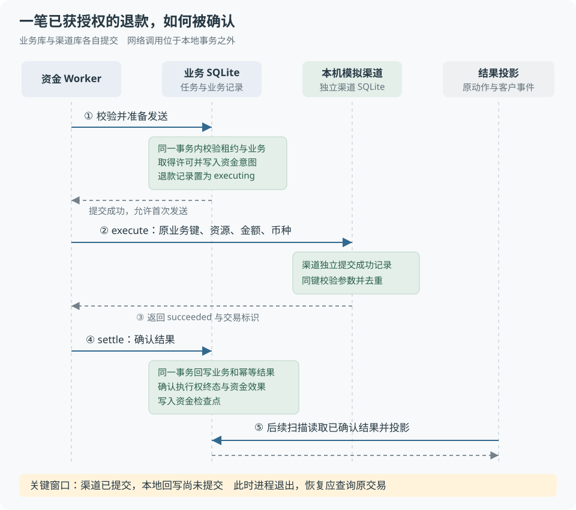
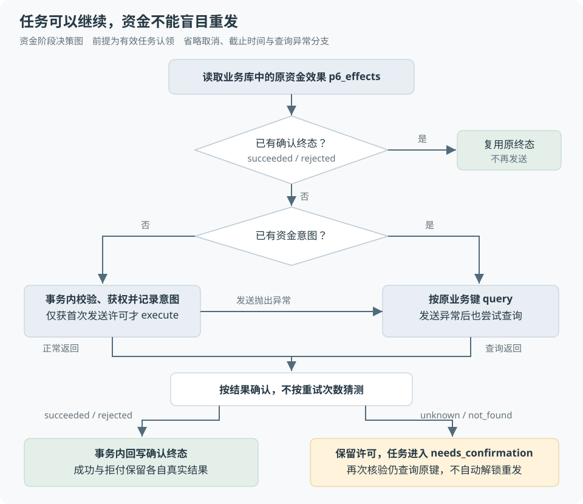

# 第 14 章 退款幂等与结果未知

客户申请退款，页面却一直没有收到成功结果。这时有两种可能：请求没有到达渠道；或者渠道已经退款，只是响应没有传回来。

**相同的超时现象，可能对应完全不同的资金事实。** 而本地没有成功记录，**不能**证明钱没有退——它也可能只是还没来得及写。

本章只讲一件事：当业务动作**已经可能产生外部副作用**之后，系统如何防止重复执行、又如何恢复。正常方案怎么建立见[B04](../03-业务逻辑详解/B04-仅退款的完整业务实现.md)。

> **阅读前提**：理解事务的提交与回滚、条件更新，以及后台任务与 HTTP 请求的区别。建议先读[第 06 章](../02-后端必要基础/06-事务唯一约束与条件更新.md)、[第 07 章](../02-后端必要基础/07-状态机与异步任务.md)和[第 13 章](13-从售后申请到审批与执行.md)。

## 设计思路：先确定要保证什么

设计需要同时满足三个要求：

1. **同一退款不能因为重复请求多执行一次。**
2. **进程退出后还能继续核验原交易。**
3. **客户看到的成功必须有业务结果支撑。**

困难在于：业务库与渠道分别保存数据，**不能用一个本地事务让两边同时提交**。而本地没有成功记录，可能只是尚未来得及写入，**不能证明渠道没有退款**。

因此发送前就需要留下可恢复的依据，**不能只在成功之后记录结果**。下面这张表把这个要求拆成七个具体对象。

## 七个概念各回答什么问题

先分清对象，再谈状态。这七个词经常被混用，但它们回答的是不同问题：

| 概念 | 回答什么问题 | 存在哪里 | 缺失或变化会怎样 |
| --- | --- | --- | --- |
| 请求幂等键 | 这次 **HTTP 输入**是否已经受理过 | `p6_commands`（客户 + 请求键 + 指纹） | 同键异参会冲突；它保护输入，不保护退款 |
| 退款业务键 | 这是**哪一笔退款** | `refund:<售后单号>`，见 `idempotency.ts` | 键不稳定就等于给同一笔退款换了身份 |
| 发送许可（执行权） | **谁被允许**发出这次资金请求 | `execution_ownership.state` | 没有它就不能首次发送 |
| 资金意图 | **哪笔动作可能已经发出** | `p6_effects`（`business_key`、`fingerprint`、`status`） | 没有它就无法判断该发送还是该查询 |
| 渠道结果 | 渠道**究竟**做了什么 | 独立渠道库（`p6_channel`） | 只有它能给出终态；本地记录不能替代 |
| 任务状态 | 这段**后台工作**进行到哪 | `p6_tasks.status` | 与业务状态、资金状态都不是一回事 |
| 检查点 | 哪一步**已经确认** | `p6_steps` | 恢复时据此复用，不重做已确认的步骤 |

最容易搞错的一处：**`sending` 不是任务状态。** 任务被认领后的状态是 `running`；`sending` 出现在资金效果（`p6_effects.status`）和执行权（`execution_ownership.state`）这两个不同对象上。

## 正常路径：两次提交，一个关键窗口



图 14-1 的标题是"一笔已获授权的退款，如何被确认"。四条泳道分别是资金 Worker、业务 SQLite（任务与业务记录）、本机模拟渠道（独立渠道 SQLite）、结果投影（原动作与客户事件）。按编号读：

1. **① 校验并准备发送**——同一事务内校验租约与业务，取得许可并写入资金意图，退款记录置为 `executing`。
2. **② execute**——把原业务键、资源、金额、币种发给渠道；渠道在自己的库里独立提交成功记录，并做同键参数校验与去重。
3. **③ 返回 `succeeded` 与交易标识。**
4. **④ settle 确认结果**——同一事务回写业务和幂等结果，确认执行权终态与资金效果，写入资金检查点。
5. **⑤ 后续扫描**读取已确认结果并投影。

图底部那句话是本章的核心：**渠道已提交、本地回写尚未提交，此时进程退出，恢复应查询原交易。**

### 首次发送许可由条件更新决定

批准决定"这笔业务**是否允许**执行"，发送许可决定"当前这条执行路径**能否**发出请求"。两者不同，而且许可必须是原子的：

```ts
// packages/persistence/src/p6-task-repository.ts 业务键跨运行共享 先持久化发送意图 再调用渠道 崩溃空窗只能查询
return this.fenced(claim, () => {
  const task = this.assertOwned(claim)
  if (task.cancelRequested || task.deadline <= this.now()) return false
  // 已有意图只允许转查询 即使还没有成功记录也不能重新发送
  if (this.effect(payment)) return false
  // 授权校验与发送许可在同一连接完成 插入意图失败则一起回滚
  prepare?.(this.db, payment, task)
  this.db.prepare(`INSERT INTO p6_effects VALUES (?,?,?,'sending',NULL,?)`)
    .run(payment.businessKey, fingerprint(payment), JSON.stringify(payment), claim.taskId)
  return true
})
```

返回值就是"这是不是首次发送"。资格判断与状态改变由**同一次**数据库操作完成，所以两个并发调用不会都读到"还没有意图"。

执行权那一侧同样用条件更新取得许可（`execution_ownership`），只有业务键、执行路径、命令持有者与原状态同时匹配才可能成功，并要求受影响行数恰好为一。这里的 token 是**资金发送许可标识**，与人工审批的一次性令牌不是同一个东西。

### 结算只认明确终态

```ts
// packages/persistence/src/p6-task-repository.ts 渠道终态与本地业务回写及检查点原子提交
// 节选 原实现还检查回写回调必须是同步的
const prior = this.effect(payment)
if (!prior) throw new Error('缺少已持久化资金意图')
if (prior.status === 'succeeded' || prior.status === 'rejected') return
// 一次查询未找到不能证明从未退款 保守保留待核验
const status = result.status === 'not_found' ? 'unknown' : result.status
// 只有明确渠道终态才回写业务 未知结果不能伪造失败或成功
if (status === 'succeeded' || status === 'rejected') {
  apply(this.db, payment, result)
}
```

注意这个细节：**渠道查询返回的 `not_found` 会被归一成存储态 `unknown`**，所以 `p6_effects.status` 里不会留下字面值 `not_found`。`not_found` 是渠道的一次回答，不是本地的资金终态。

## 为什么本地事务覆盖不了渠道

业务库和渠道库是两套独立存储，各自提交。**本地事务只能保证"我这里"要么全成功要么全回滚，它无法把渠道的动作一起纳入。** 于是必然存在一个空窗：

```text
本地：  [ 写发送意图 ] ──────────────► [ 回写结果 ]
渠道：            [ 收到请求并成功 ]  ← 空窗在这里
```

必须提前留下可恢复的依据，**不能只在成功之后才记录**。这就是"先写意图、再调渠道"的顺序不能颠倒的原因：顺序反过来，崩溃后本地无法区分"没发"和"发了没记"。

> **边界**：本项目不能、也不声称做到"恰好一次"。可以做到的，是在**遵守同一业务键与执行权协议**的前提下，优先防止重复副作用；代价是部分不确定状态需要人工核验。任何"资金绝不重复"的绝对说法都超出了当前证据。

## 两个必须处理的故障窗口

两个窗口看起来相似，恢复动作却不同。区别在于**恢复时能拿到什么事实**。

| 窗口 | 恢复时可用的关键事实 | 该做什么 | 禁止什么 | 为什么 |
| --- | --- | --- | --- | --- |
| **窗口一**：发送意图已提交，进程在真正调用渠道前退出 | `p6_effects` 有 `status='sending'` 的意图；执行权已取得；渠道按原业务键查询**没有终态** | 按原业务键查询渠道；查不到就保留待核验，需要时走人工核验 | 不能因为"本地看起来没发"就重新发送；不能删掉 `sending` 记录来"重置" | 本地无法仅凭记录区分"尚未发出"与"已发出但响应未回" |
| **窗口二**：渠道已成功，但本地结算／投影前退出 | 渠道库有 `succeeded` 与交易标识；业务库意图仍是 `sending`；退款仍 `executing` | 按原业务键查询 → 拿到明确成功 → `settle` 在事务内回写业务、执行权终态、资金效果与检查点 | 不能重新 `execute`；不能把未知记成失败；不能因租约到期释放许可 | 渠道的动作不会因为本地租约到期而撤销 |

还有一个相邻窗口：**业务结果已回写、客户事件尚未投影**。此时恢复只需补投影，不再触碰资金，详见[第 16 章](16-跨进程恢复与人工核验.md)。

### 为什么查询未找到仍然不重发

`not_found` 被视为"尚未确认的资金结果"。**一次查询未找到，不足以授权再次发送**，因为项目没有定义更强的渠道契约来证明"该请求永远不可能生效"。

这是有意的保守：进程若在窗口一退出，实际上可能真的没退款，但系统仍会停在待核验状态。它优先保证不重复扣款，代价是牺牲一部分自动恢复能力——**不能据此宣称任何故障都能自动恢复**。

另外，"结果未知"和"退款失败"是两件事：前者表示缺少终态证据，后者必须有业务或渠道依据。

## 决策只有发送与查询两种



图 14-2 的标题是"任务可以继续，资金不能盲目重发"。它的判断顺序是：先读 `p6_effects` → **已有确认终态吗？**（`succeeded` / `rejected`）→ 是则复用原终态、不再发送；否则 **已有资金意图吗？** → 没有意图才在事务内校验、获权并记录意图，且**只有拿到首次发送许可才 `execute`**；已有意图则按原业务键 `query`，**发送抛异常后也尝试查询**。最后一步写着"按结果确认，不按重试次数猜测"：`succeeded` / `rejected` 走事务内回写终态，`unknown` / `not_found` 保留许可并让任务进入 `needs_confirmation`。

代码里这个判断就是一行：

```ts
// packages/runtime/src/p6-worker.ts 只有本次事务新建资金意图才允许首次发送 其他情况查询原交易
const shouldSend = this.repo.beginPayment(task, payment, this.ports.preparePayment)
result = shouldSend
  ? await this.call(signal, (s) => this.ports.payment.execute(payment, s))
  : await this.call(querySignal, (s) => this.ports.payment.query(payment.businessKey, s))
```

未知结果的任务终态也只有一处：

```ts
// packages/runtime/src/p6-worker.ts 未找到也不释放发送许可 常规扫描暂停等待明确核验
if (result.status === 'unknown' || result.status === 'not_found') {
  this.repo.finish(task, 'needs_confirmation', '资金结果未知 只允许查询或人工核验')
  return
}
```

**租约到期只影响谁可以继续处理任务，不会撤销渠道已经发生的动作。** 因此任务执行资格可以交给新 Worker，资金发送许可必须保留。发送抛出异常时也会先尝试查询，查询失败不能成为释放许可的理由。

## 状态对照：它们是不同对象的状态

未知结果不要求所有表统一叫 `unknown`。下面几种状态可以同时成立，它们各自描述不同对象：

| 位置 | 描述的对象 | 未知结果时的典型状态 | 含义 |
| --- | --- | --- | --- |
| `execution_ownership` | 谁被允许发送 | `owner='p6'`、`state='sending'` | 许可已取得，不能再次从 `ready` 获权 |
| `p6_effects` | 哪笔动作可能已发出 | `sending` 或 `unknown` | 资金终态尚未确认 |
| `p6_tasks` | 这段后台工作 | `needs_confirmation` | 常规执行暂停，等待核验 |
| `refunds` | 这笔钱 | `executing` | 不能写成已成功或明确拒付 |
| `p6_channel` | 渠道交易 | 可能没有对应行，或状态非 `succeeded` | 本地渠道库也不保证立刻给出终态 |

未知结果不会进入执行权终态回调，所以许可继续保留。更早的退出窗口还可能让资金效果也停在 `sending`——**不能把它理解为"渠道已确认正在处理"**。

人工接管不会清除这些事实。手动触发 `reconcile` 后，任务仍按原意图查询。客户取消也不等于资金回滚：如果核验发现渠道已退款，必须保留成功事实。

## 验证依据

**"是否重复提交"和"是否重复发生资金动作"必须分别检查。** 模拟渠道用两个字段回答这个问题：`submissions` 记录收到的提交次数，`charges` 记录成功资金动作次数。两次提交、一次动作，只能说明渠道去重生效，不能说明 Worker 没有重发。

| 验证问题 | 条件与证据 |
| --- | --- |
| 渠道成功、本地未落账时能否恢复 | 2026-09-26 进程实验摘要（`after-payment-response`）：29900 分，提交 1 次、资金动作 1 次、查询 1 次、客户完成事件 1 次。条件是**脚本模型 + 本机模拟渠道** |
| 手动恢复后查询未找到，是否重发 | [持久任务测试](../../../packages/runtime/test/p6-durable.test.ts)：发送 1 次、查询 1 次，仍为待核验 |
| 人工接管是否错误释放未知许可 | [客户退款测试](../../../apps/api/test/conversation-refund.test.ts)：许可保留，渠道计数不增加 |
| 两个进程能否同时取得执行权 | [执行权竞争测试](../../../packages/persistence/test/execution-ownership-repository.test.ts)、[模块实验记录](../../experiments/execution-ownership.md) |
| 本机夹具中的计数与恢复 | 2026-09-27 [P11 演示摘要](../../experiments/p11-learning-evidence/demo-summary.json)：两笔成功各 1 次提交／1 次动作，另一笔 `unknown` 为 1 次提交／0 次动作 |

2026-09-27 曾核查当前持久退款路径的源码与已有记录，**未重新运行这些测试**；摘要所指的当次原始进程目录当前未找到，因此不能宣称已复核当次数据库副本。这些证据都不代表真实支付渠道或生产规模验证。

## 设计取舍

这套机制的成立条件，是相关执行入口遵守同一业务身份与执行权协议，并保留必要记录。**绕过守卫直接发送、删除未知记录、换业务键重试，都会破坏这些条件。**

当前选择"**保留未知、限制重发**"，代价是部分退款需要进一步核验。若将来接入真实渠道，更主动的恢复至少需要先确认：

1. **幂等契约**：键的有效期、同键异参行为和重放语义。
2. **查询契约**：结果何时可见，"未找到"与终态分别保证什么。
3. **核验机制**：如何获得权威证据并安全补齐本地记录。

这些是替代方案的**前提**，不是当前已完成能力。项目尚未验证真实渠道，也没有交付完整的自动对账闭环。

---

本章学习衔接：[渐进重建练习四与五](../09-练习与自测/渐进重建练习.md) · [源码跟读实验](../09-练习与自测/源码跟读实验.md) · [集中自测第 14 组](../09-练习与自测/集中自测.md) · [返回导学](../导学-有据售后.md)

业务对照：[B04-仅退款的完整业务实现](../03-业务逻辑详解/B04-仅退款的完整业务实现.md)。
