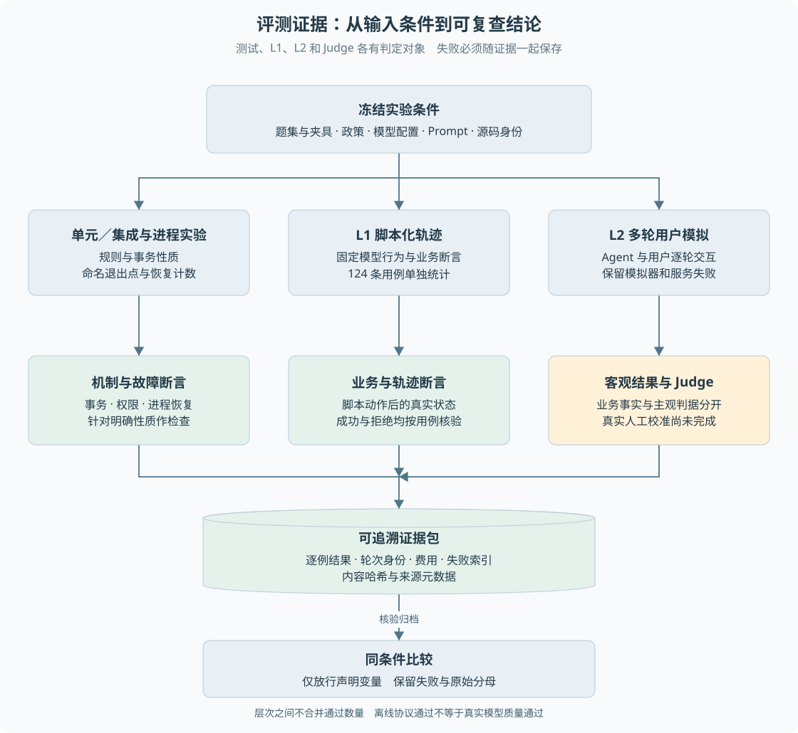

# 第 20 章 测试、L1、L2 与 Judge

"测试全部通过"和"客户任务成功率很高"不是同一个结论。一个系统可能严格阻止重复退款，却经常让模型误解客户；也可能回复自然，却在超时后重复执行资金。

**质量证据必须说明测量对象、输入条件、成功定义和分母。** 本章先把四种评测的对象分清，再进入指标、Judge 与证据包。

> **阅读前提**：先读[第 09 章](../04-Agent机制/09-原生工具调用与Agent循环.md)、[第 16 章](../05-资金执行与恢复/16-跨进程恢复与人工核验.md)和[第 18 章](../06-交互与运行治理/18-模型预算与费用账本.md)。本章不重复工具循环的实现，只说明**怎么测量和归因**它的行为。

## 设计思路：先分清测量对象，再谈指标

最小验证是手动输入一条退款请求、看到结果正确。它有助于检查流程，但**无法持续比较变更**，也难以覆盖权限、协议、预算与崩溃窗口。把这些问题都塞进一个"通过率"，就等于用一个数字掩盖了完全不同的失败原因。

所以先把证据分层，再给每层定义成功与分母。先建立下面这张表，后面所有指标才有位置放。

| 层次 | 判定对象 | 检查什么 | **不检查什么** | 本项目现状 |
| --- | --- | --- | --- | --- |
| 单元与集成测试 | 代码性质 | 规则、事务、权限、协议、接口、前端状态等可精确描述的性质 | 真实模型行为、真实渠道 | 已有，全仓测试按单次运行统计 |
| 进程实验 | 恢复行为 | 在**命名退出点**退出后，新进程能否依据持久记录继续 | 其他未命名的故障点 | 已有，覆盖受理、模型响应、业务受理、渠道响应、投影等边界 |
| L1 脚本化评测 | 宿主治理行为 | 固定脚本模型发出既定动作后，系统是否正确地执行、拒绝、等待 | **模型是否会选对动作** | 124 条固定用例，可离线零成本回归 |
| L2 用户模拟评测 | 多轮任务完成 | Agent 与模拟用户逐轮交互，任务能否完成、失败出在哪一环 | 客观资金事实、生产分布 | 当前离线入口可跑；真实模型成绩属历史实验 |
| Judge | 主观判据 | 解释完整性等无法用字段表达的标准 | **客观业务事实**，不能推翻数据库结果 | 协议约束已实现；**真实人工校准尚未完成** |

一个常见误读是把这五层"加总"。它们的分母不同、判定对象不同，**相加没有意义**。

## 第二步：为什么它们不能互相代替

用一个售后任务说明三层差距：

> 客户说"东西有问题想退"。系统最终回复了一段很像样的处理说明。

| 观察到的现象 | 看起来像成功 | 还缺什么证据 | 该用哪一层 |
| --- | --- | --- | --- |
| 回复文字完整、语气得体 | 客户任务完成了 | 退款单是否真的成功、渠道是否真的扣了款 | 业务断言 + 渠道计数（L1 或集成测试） |
| 固定用例全部通过 | 系统对任何客户都能正确处理 | 模型在真实表达下会不会选错工具 | L2 用户模拟 + 真实模型实验 |
| Judge 判定"解释充分" | 质量没问题 | 客观资金事实是否正确 | 业务断言（Judge 无权改判） |

所以三句话要记住：

1. **最终文本看起来正确，不代表真实业务成功。**
2. **脚本测试通过，不代表真实模型智能表现好。**
3. **Judge 通过，不代表客观资金事实正确。**

## 第三步：成功、断言与失败分类的关系

L1 用例的断言分几类，它们是并列的证据，不是同一种"通过"：

- **业务断言**（`expectedState`）：检查数据库终态，例如退款 `succeeded`、售后 `completed`、审批记录存在。
- **轨迹断言**（`trajectory`）：检查必需或禁止的动作是否发生，而不是要求路径唯一。
- **参数断言**（`toolArgs`）：检查工具参数的关键字段，防止"动作对了、参数错了"。
- **交互断言**：`expectEscalation`、`expectClarify`、`expectGatewayCharges`。
- **Judge 判据**（`judgeRubric`）：只覆盖主观项，客观项全部由代码判定。

用例定义在共享契约里（`turns` 是用户回合，`modelScript` 是按调用顺序消耗的脚本动作），所以用例本身就是可校验的数据。

失败被分成七类，**一条用例可以同时命中多类**，因此分类计数不能相加当作独立用例数：

| 失败类型 | 说明 |
| --- | --- |
| `business_assertion` | 业务终态不符 |
| `model_protocol` | 协议不合法、轮次截断、缺用量 |
| `service_exception` | 其他服务异常 |
| `timeout_cancel` | 超时或被取消 |
| `budget_blocked` | 被预算或并发限制阻断 |
| `evidence_missing` | 缺少可核验的业务证据 |
| `judge_failure` | 主观判据未通过 |

**业务成功与综合通过必须分开报告。** 客观业务断言通过而 Judge 失败时，应保留"业务做对、主观判据未通过"的区别，不能让业务成功率悄悄换分子。

图 20-1 的标题是"评测证据：从输入条件到可复查结论"，副标题写着"测试、L1、L2 和 Judge 各有判定对象，失败必须随证据一起保存"。它自上而下表达四件事：先**冻结实验条件**（题集与夹具、政策、模型配置、Prompt、源码身份），再让三种驱动方式（单元／集成与进程实验、L1 脚本化轨迹、L2 多轮用户模拟）各自判定，然后**分开**承载客观结果与 Judge，最后归档成含逐例结果、轮次身份、费用与失败索引的**可追溯证据包**，并在**同条件比较**下只放行声明过的变量。图底部那句话是全章结论：**层次之间不合并通过数量，离线协议通过不等于真实模型质量通过。**

## 当前的 L1 实现

L1 使用脚本化模型（`ScriptedModel`），使行为轨迹可控。它适合验证：某工具输出后能否正确推进、越权请求是否被拒绝、审批和幂等是否成立、异常是否形成预期状态。

当前正式 L1 数据集共 **124 条**，按分类分布如下（数据取自 `packages/eval/src/cases/`，逐文件统计三种字段互校一致）：

| 分类 | 条数 | 分类 | 条数 |
| --- | --- | --- | --- |
| happy-path | 11 | compensation | 8 |
| clarification | 5 | logistics | 8 |
| policy-boundary | 9 | price-protection | 6 |
| approval | 6 | policy-rag | 3 |
| rejection | 4 | handover | 6 |
| fault-injection | 10 | sim-hard | 17 |
| security | 23 | regression | **0**（目录为空，不改变 124 条基数） |
| recovery | 8 | **合计** | **124** |

`regression` 分类从仓库目录载入而非内联，**空目录贡献 0 条**——这正是"坏例必须显式采纳才能进回归"的设计后果。

**L1 证明什么**：脚本已经告诉系统模型将发出哪些动作，主要检验的是**动作被宿主如何执行和治理**。它适合做零成本回归门禁（P0 全通过才放行）。

**L1 不证明什么**：它不检验模型能否在真实表达下选对动作。**124/124 不是模型问答准确率。**

## 当前的 L2 实现

L2 用模拟客户与 Agent 逐轮交互，允许模型决定下一步。失败可能来自 Agent 选错动作，也可能来自模拟用户没按场景提供信息、供应商故障或裁判误判——所以必须保存原始对话与工具轨迹，**不能只根据最终一句答复判定**。

注意区分两类 L2 结果：

- **当前离线 L2**（`pnpm eval:sim`）：验证角色协议、预算归因和判定机制，不提供当前真实模型能力成绩。
- **历史真实模型实验**：数据集规模、Prompt 和环境都不完全相同，**不同比较条件下的百分比不能直接写成某个改动的收益**，也不代表当前版本质量。

## Judge 的协议约束与校准现状

Judge 接收判据和对话，返回结构化结论。它的输出本身也要被严格校验：

1. 必须是完整轮次，且停止原因是正常结束。
2. JSON 必须能解析，判据不能缺失、重复或出现未知项。
3. `passed` 必须是真正的布尔值。
4. **未通过的项必须给出非空理由。**
5. 解析时**不过滤非法条目**——过滤掉非法项会造出"空集合通过"的假象。

超时默认 10 秒：支持取消的适配器要传播 `AbortSignal` 并**等待网关与观察器收尾**，避免报告导出后调用记录还在变化；迟到结果不能重新改变判定。

这些机制只证明**裁判协议有约束，不证明裁判判断与人类一致**。校准需要真实标注样本、证据哈希、判据版本和标注者身份：

- 当前元数据里的校准状态固定为 `not_calibrated_no_real_human_labels_or_judge_outputs`。
- 真实人工标签数为零时，一致率返回 `null`，**不是 100%**。
- 合成标签只用于检验统计函数，不能算作校准样本。

## 证据包为什么要保存来源

公平比较要求条件可解释。每个证据包会记录：

| 内容 | 作用 |
| --- | --- |
| 数据集哈希、所用子集哈希、用例顺序 | 前后两次是否在比同一批题 |
| `repeat` | 跑了多少轮 |
| 政策版本、知识哈希、夹具哈希 | 业务规则与语料是否变化 |
| 源码内容清单与身份 | 镜像里的实际源码，而不是伪造的提交号 |
| 逐例结果、失败索引、轮次身份、费用引用 | 每条结论能否复查 |
| 内容哈希 | 篡改可被发现 |

核验函数 `verifyQualityBundle` 不只确认文件存在，还核对内容、引用身份与失败分类：清空失败索引、修改某条结果或改变失败判定，都会让哈希对不上而拒绝通过。**成功判定不得同时带失败分类。**

比较只允许显式声明 `model`、`prompt`、`fault` 三类变量；没有声明却改变模型或故障设置时，不输出貌似精确的改进差值。声明一个变量也不能顺便夹带超时等其他配置变化。

## 坏例怎样进入回归

固定题集只解决"已知轨迹能否重复通过"。一次真实或本机会话失败后，若只能靠人工回忆改写成用例，回归会落后于现场。当前的流程是两步：

1. `case:from-run` 把一次 `run` 的事件流导出为 L1 草稿：用户消息成为 `turns`，模型工具调用成为 `modelScript`，终态写入断言，冻结时间取会话创建时刻。草稿默认使用 baseline 夹具，并标出需要人工核对的字段，只写入 `eval/traces`。
2. **必须再执行带显式编号的 `case:adopt`**，草稿才会进入 `regression` 分类。空目录不增加现有 124 条基数。

禁止把未审查的对话自动训练成政策或提示词。夹具与真实会话数据不一致时，重放失败说明**草稿还不能作为回归**，而不是 L1 失效。

同一套事件还可以映射为 OTLP JSON 做离线校验，便于对照用量、工具延迟和压缩记录。这证明会话事实能转成标准追踪结构，**不表示已经接入外部 collector 或开始在线采样**。

## 进阶指标（可以先跳过）

稳定性指标回答不同问题，不要混用：

- **Pass@k** 侧重多次机会中是否**至少成功一次**。它很高，也可能每次结果都在波动。
- **Pass^k** 在本项目语境下强调重复尝试**连续全过**的稳定性。项目实现的是按同一用例跨轮全部通过的 `computePassPowerK`，不能把它当作另一种指标的已实现估计器。

报告用 Wilson 95% 区间表达部分成功率的不确定性，但置信区间不会自动证明样本独立、代表真实用户分布或随机过程稳定。

**空样本必须显式处理**：指标函数在分母为零时返回 1，因此报表或口述不能只读数值字段，把"没有观察"解释成"100% 可靠"。项目另有 `metricDenominators` 显式提供每项分母；Wilson 在零样本时返回 `[0, 1]`，表示完全未知。**应同时展示分母，零样本标为无证据。**

## 一组故障对照怎样解读

2026-09-26 P9 修复后的离线记录中，正常两轮各运行同一套 124 条 L1，用例观察总计 248/248；受控第二轮协议故障时总计 124/248，按预期失败。

这不是 248 个独立新问题，而是 **124 个问题各重复两次**。正常与故障是两个实验，不能合并成"496 条"的成功率。故障实验费用降低也不是同质量省钱，因为第二轮没有完成相同工作，还留下未知费用。

这个对照证明**报告能够保留故障并拒绝错误比较**，属于离线评测机制验证；它不证明真实模型准确率，也不应作为生产故障率。

## 数字口径

引用任何数字前先对照这张表。

| 数字 | 日期与对象 | 层级与分母 | 可以怎么解释 | 不能怎么解释 |
| --- | --- | --- | --- | --- |
| 124/124 | 历史正式 HTTP 离线 L1，见[P10 修复交接](../../handoffs/p10-source-manifest-fix.md) | L1 固定用例／124，脚本模型 | 固定用例下的治理行为通过 | 模型问答准确率；本轮重新执行 |
| 692/692 | 2026-09-26 P10 修复记录（同上交接文件） | 全仓单元／集成测试，单次运行 | 该次源码条件下的测试通过 | 与 L1 相加成"816 条智能问答准确率"；**该次运行的原始日志未随仓库保留，本轮无法复现** |
| 33/105 = 31.4% | 历史真实模型 L2 基线（v2 提示词） | L2 全量单轮／105 | 当时条件下的模型行为观察 | 当前版本质量 |
| 58/111 = 52.3% | 历史真实模型 L2（v2.3 三轮迭代后） | L2 全量单轮／111 | 当时条件下的模型行为观察 | 线上效果；与上一行直接相减当作单一改动收益 |
| Pass^3 35.1% / Pass@3 83.8% | 同上历史实验 | 同一用例集三轮 | 稳定性与能力上限分离 | 单轮波动小 |
| 9/25 = 36% | v2.4 安全段专项 | L2 安全段／25 | 安全分流首版观察值 | 已达标（简单档目标 40%） |
| 248/248 与 124/248 | 2026-09-26 P9 修复实验 | 124 题各两轮 | 报告能保留故障并拒绝错误比较 | 248 个独立新题或真实稳定性估计 |

`LIMITATIONS.md` 同时存在 L2 的 105 条与 111 条两套分母，属于**不同版本的数据集**；引用时必须带版本，否则容易串。

## 已实现与尚未验证

| 能力 | 状态 |
| --- | --- |
| 单元／集成测试、进程恢复实验 | 已实现 |
| L1 脚本化回归（124 条）与 P0 门禁 | 已实现 |
| 离线 L2 机制验证 | 已实现 |
| 逐例证据包、失败分类、哈希核验、比较约束 | 已实现 |
| 会话转 L1 草稿 + 显式采纳 | 已实现，草稿需人工核对 |
| OTLP JSON 离线导出 | 已实现（未接外部平台） |
| Judge 与真实人工标注的校准 | **未完成**，一致率为 `null` |
| 当前版本真实模型质量 | 未验证 |
| 真实支付渠道结果 | 未验证 |
| 在线采样与线上监控 | 未实现 |

## 源码参考与证据

| 入口 | 内容 |
| --- | --- |
| [`cases.ts`](../../../packages/eval/src/cases.ts)、[`cases/`](../../../packages/eval/src/cases)、[`trace-extract.ts`](../../../packages/eval/src/trace-extract.ts) | 数据集结构、会话转草稿 |
| [`runner.ts`](../../../packages/eval/src/runner.ts)、[`validators.ts`](../../../packages/eval/src/validators.ts) | L1 运行与断言实现 |
| [`metrics.ts`](../../../packages/eval/src/metrics.ts) | 指标聚合、分母、Wilson、Pass^k |
| [`judge.ts`](../../../packages/eval/src/judge.ts) | 主观判定的输出校验与取消 |
| [`p9-report.ts`](../../../packages/eval/src/p9-report.ts)、[`p9-metadata.ts`](../../../packages/eval/src/p9-metadata.ts)、[`p9-calibration.ts`](../../../packages/eval/src/p9-calibration.ts) | 失败分类、证据核验、条件元数据、校准状态 |
| [P9 修复实测](../../experiments/p9-fixes.md)、[归档摘要](../../experiments/p9-validation-summary.md) | 最终离线结果与证据保存范围 |

评测的目标是让错误可以归因和复查，而不是让表格看起来漂亮。**新增能力时应先定义成功证据与失败分类，再考虑增加模型或调整 Prompt。**

---

本章学习衔接：[源码跟读实验](../09-练习与自测/源码跟读实验.md) · [渐进重建练习七](../09-练习与自测/渐进重建练习.md) · [集中自测第 20 组](../09-练习与自测/集中自测.md) · [返回导学](../导学-有据售后.md)

业务对照：[B09-物流事实与服务评价](../03-业务逻辑详解/B09-物流事实与服务评价.md)。
